 

## About

<b>Read the full story</b>

 

I started out tinkering with hardware in college, writing code that talked directly to machines. That curiosity grew into mobile apps, then web, then backend systems, and now I'm deep in **AI and cybersecurity**.

Today I build **backend systems for cybersecurity SaaS products**: Attack Surface Monitoring, Threat Intelligence, SAST, DAST and CSPM platforms. **Golang** is my weapon of choice for high-performance, scalable APIs. **Python** is my second language for everything else.

What excites me most right now is **AI agents**. I build autonomous agents with LangChain, LangGraph, Deep Agents and open-source tools that automate complex operations that once took hours of human effort.

Away from the screen, I build **FPV freestyle drones from scratch**: every component, every wire, every tune. I'm a licensed drone pilot exploring ways to make a real-world impact with it.

## Tech Stack

**Backend & Infrastructure**  

  

**AI Agents**  

  

**Embedded & Drones**  

## Mission Control

Stats and language orbits regenerate daily via GitHub Actions.

## Contribution Skyline

## Astronomy Picture of the Day

Cosmology is my other obsession. NASA's picture of the day, refreshed here automatically.

<!-- APOD:START -->

<b>The Moon Watchers</b> 
📅 2026 November 27 · via <a href="https://science.nasa.gov/apod/">NASA APOD</a>

🔭 Read NASA's explanation

 

On November 24, all denizens of our fair planet could watch the Moon rise opposite the setting Sun. Easy to spot in twilight skies above fields, fences, backyards, and even stone walls, the Moon was big and bright, and at its full phase. Known to some as a Beaver Moon, November&#x27;s Full Moon was also near perigee, the closest point in its elliptical orbit around planet Earth. That made it one of the biggest and brightest Full Moons, also known as a supermoon. In fact, November&#x27;s Full Moon was the first in a series of four consecutive Full Moons near perigee. So your next chance to watch a supermoon rise will be when the Cold Moon rises on December 23.

<!-- APOD:END -->

## Let's Connect

 

> *"The cosmos is within us. We are made of star-stuff. We are a way for the universe to know itself."*
>  — Carl Sagan

