<div align="center">


<br/>

<a href="mailto:aswinvenkat60@gmail.com"></a>


</div>

## About

I started out tinkering with hardware in college, writing code that talked directly to machines. That curiosity grew into mobile apps, then web, then backend systems, and now I'm deep in **AI and cybersecurity**.

Today I build **backend systems for cybersecurity SaaS products**: Attack Surface Monitoring, Threat Intelligence, SAST, DAST and CSPM platforms. **Golang** is my weapon of choice for high-performance, scalable APIs. **Python** is my second language for everything else.

What excites me most right now is **AI agents**. I build autonomous agents with LangChain, LangGraph, Deep Agents and open-source tools that automate complex operations that once took hours of human effort.

Away from the screen, I build **FPV freestyle drones from scratch**: every component, every wire, every tune. I'm a licensed drone pilot exploring ways to make a real-world impact with it.

```yaml
role:        Backend Engineer — Cybersecurity SaaS
platforms:   [Attack Surface Monitoring, Threat Intelligence, SAST, DAST, CSPM]
languages:   { primary: Go, secondary: Python }
building:    Autonomous AI agents (LangChain · LangGraph · Deep Agents)
roots:       Embedded systems → mobile → web → backend → AI
off_screen:  FPV freestyle drones — built, tuned and flown by hand
certified:   Licensed drone pilot
```

## Tech Stack

<div align="center">

**Backend & Infrastructure**<br/><br/>


<br/><br/>

**AI Agents**<br/><br/>


<br/><br/>

**Embedded & Drones**<br/><br/>


</div>

## Mission Control

<div align="center">



<sub>Stats and language orbits regenerate daily via GitHub Actions.</sub>

</div>

## Contribution Comet

<div align="center">

<picture>
  <source media="(prefers-color-scheme: dark)" srcset="https://raw.githubusercontent.com/aswin-kevin/aswin-kevin/output/comet-dark.svg"/>
  <source media="(prefers-color-scheme: light)" srcset="https://raw.githubusercontent.com/aswin-kevin/aswin-kevin/output/comet-light.svg"/>
  
</picture>

</div>

## Astronomy Picture of the Day

<sub>Cosmology is my other obsession. NASA's picture of the day, refreshed here automatically.</sub>

<!-- APOD:START -->
<div align="center">

<a href="https://science.nasa.gov/image-article/apod-2026-november-26-eye-in-the-sky-the-milky-way-over-lencois/"></a>

**Eye in the Sky: The Milky Way over Lençóis**<br/>
<sub>📅 2026 November 26 · via <a href="https://science.nasa.gov/apod/">NASA APOD</a></sub>

<details>
<summary><sub>🔭 Read NASA's explanation</sub></summary>
<br/>
<p align="left">Beauty is in the eye of the beholder. And there is much to behold in today&#x27;s featured image. The Milky Way shines bright in the sky of Brazil, over the white sand dunes and dark lagoons of Lençóis Maranhenses National Park. We can see different parts of the Milky Way as it apparently rotates in the sky every night and throughout the year. This composite image was taken later in the night in July from a latitude of approximately 2º south. It shows some prominent Milky Way features, such as dark dust lanes and colorful nebulas. But does the Galaxy really appear arched like a rainbow in the sky? No, this is an artifact of a picture taken with a wide-angle lens. As the Galaxy was artfully framed by the photographer, it matches the contour of the dark lagoon creating the illusion of a cosmic eye, half in space and half on the ground. Is this eye in the sky looking back at you?Tomorrow&#x27;s picture: what&#x27;s next?</p>
</details>

</div>
<!-- APOD:END -->

## Let's Connect

| | If you're into… |
|:-:|:--|
| 🤖 | Building or exploring **AI agents** |
| 🚁 | **FPV drone** building and freestyle flying |
| 🔐 | **Cybersecurity** product development |
| ⚙️ | **Golang**, scalable backends, or **DevOps** |

…reach out at **[aswinvenkat60@gmail.com](mailto:aswinvenkat60@gmail.com)**.

<div align="center">

<br/>

> *"The cosmos is within us. We are made of star-stuff. We are a way for the universe to know itself."*
> <br/>— Carl Sagan


</div>
