<div align="center">


<a href="https://github.com/aswin-kevin">
  
</a>

<br/>


<a href="mailto:aswinrj6067@gmail.com"></a>

</div>

<br/>

## 🛰️ Mission Log

```yaml
commander:          Aswin Venkat
home_planet:        Earth — the pale blue dot, 3rd rock from the Sun
primary_mission:    Cybersecurity — building tools that defend
side_quests:        [Web Development, Mobile Apps, AI Agents]
currently_training: Robotics 🦾
seeking_crew:       Collaborators for cybersecurity tool development
comms_channel:      aswinrj6067@gmail.com
obsession:          Cosmology — where it all began, and where it's all going
```

## 🧰 Spacecraft Systems

<div align="center">


</div>

## 📡 Mission Control

<div align="center">


<sub>Telemetry and language orbits regenerate every day via GitHub Actions.</sub>

</div>

## ☄️ A Comet Devouring My Contribution Galaxy

<div align="center">

<picture>
  <source media="(prefers-color-scheme: dark)" srcset="https://raw.githubusercontent.com/aswin-kevin/aswin-kevin/output/comet-dark.svg"/>
  <source media="(prefers-color-scheme: light)" srcset="https://raw.githubusercontent.com/aswin-kevin/aswin-kevin/output/comet-light.svg"/>
  
</picture>

</div>

## 🔭 Today's View From the Telescope

<sub>NASA's Astronomy Picture of the Day — refreshed here automatically every morning.</sub>

<!-- APOD:START -->
<div align="center">

<a href="https://science.nasa.gov/image-article/apod-2026-november-26-eye-in-the-sky-the-milky-way-over-lencois/"></a>

**Eye in the Sky: The Milky Way over Lençóis**<br/>
<sub>📅 2026 November 26 · via <a href="https://science.nasa.gov/apod/">NASA APOD</a></sub>

<details>
<summary><sub>🔭 Read NASA's explanation</sub></summary>
<br/>
<p align="left">Beauty is in the eye of the beholder. And there is much to behold in today&#x27;s featured image. The Milky Way shines bright in the sky of Brazil, over the white sand dunes and dark lagoons of Lençóis Maranhenses National Park. We can see different parts of the Milky Way as it apparently rotates in the sky every night and throughout the year. This composite image was taken later in the night in July from a latitude of approximately 2º south. It shows some prominent Milky Way features, such as dark dust lanes and colorful nebulas. But does the Galaxy really appear arched like a rainbow in the sky? No, this is an artifact of a picture taken with a wide-angle lens. As the Galaxy was artfully framed by the photographer, it matches the contour of the dark lagoon creating the illusion of a cosmic eye, half in space and half on the ground. Is this eye in the sky looking back at you?Tomorrow&#x27;s picture: what&#x27;s next?</p>
</details>

</div>
<!-- APOD:END -->

<br/>

<div align="center">

> *"The cosmos is within us. We are made of star-stuff. We are a way for the universe to know itself."*
> <br/>— **Carl Sagan**



</div>
